# Walled

> **For security and IT teams:** see [docs/ENTERPRISE.md](docs/ENTERPRISE.md) for the architecture, data inventory, the 12 enforced guardrails, deployment and operations, and the mapping to DPDP, GDPR, ISO 27001 and SOC 2.

**Guard what you share with AI.** Walled is a desktop app, a Chrome extension and your own private Telegram bot, all working together:

| Where | What Walled does | Origin |
|---|---|---|
| **ChatGPT, Perplexity, Claude.ai** | Checks every prompt and upload (text, PDF, image) **before it leaves the browser**. When something matches your rules, a **native desktop dialog** asks *Continue* or *Cancel*. AI answers are recoloured. | Screening 2 |
| **Claude Desktop tools (MCP)** | Each tool call waits for **Allow / Block on Telegram**. Calls with sensitive data hide their inputs and can't be "always allowed". | Screening 1 |
| **Logins on any site** (opt-in) | Suggests strong passwords and fills logins from an **encrypted local vault**. Fills are approved on Telegram or in a dialog. | New |
| **Your clipboard** | Copy a token or API key and Walled warns you, then clears the clipboard after 60 s. | New |

### Meet Pip

<p align="center">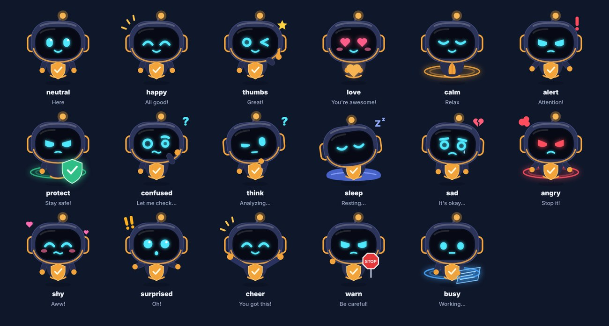</p>

**Pip** is Walled's guardian. He's drawn after the *AI Guard Assistant* character sheet ([`assets/pip-character-sheet.png`](assets/pip-character-sheet.png), with *Protecting* in green). Features:

- a wide helmet head with ear pods and an orange antenna;
- a glossy screen face with glowing cyan eyes;
- a small floating body with an orange shield.

He is vector art with 16 expressions, so he stays crisp at any size and animates smoothly.

He lives in a **corner of your screen**, in a small transparent window that stays on top. If he can't run on the desktop, he lives in the corner of ChatGPT, Perplexity and Claude instead. Most of the time you won't notice him: he stands guard (green shield), blinks, glances around, paces, plays with a spark, works on his little hologram laptop, meditates, naps, and **now and then vanishes** for a while before beaming back.

He's never just standing there. Between watches he paces, hops, spins, chases a spark, dances, waves, stretches, works on his little laptop, meditates, naps, and plays peek-a-boo. Now and then he even **asks for a pat**: pet him and he's delighted; ignore him and he sulks for a moment. Pet him too long and he gets grumpy and walks off.

**Two gestures, that's all:**

| Do this | Pip does |
|---|---|
| **Stroke him** with the pointer | gets shy, then 💕 love, hearts float up. You hear the sound you picked: a soft **purr**, **chimes** (always in tune) or **bubbles**. Pet too wildly and he grumbles for a second. |
| **Click him** | opens one small panel: how things are, petting sound, volume, mood (Calm / Playful / Focus), **Open Walled**, **Nap 1 h**, **Hide** |

The first time, he says hello and shows you both gestures. Keyboard works too: Tab to him, then Enter.

**When something matters, he speaks up clearly,** with the right face and a soft sound for that kind of news:

| What happened | Pip's face | Note | Sound |
|---|---|---|---|
| You cancelled a send with sensitive data | **Protecting** (green) | "Psst — I held that back", with the site and the rule | warm two-note "hey", then once more softly |
| A Block rule stopped it | **Warning** (stop sign) | "Stopped by your rule" | the same, calm |
| Claude is waiting for Allow / Block | **Alert** | "Claude is waiting for you" | two gentle knocks |
| Telegram paired, vault ready | **Encouraging** | short happy note | rising marimba |
| Test passed, you chose Continue | **Thumbs up** | short note that closes on its own | soft chime |
| Something failed | **Sad** | what went wrong | soft chime |
| Can't reach Walled for a moment | **Confused** | (none; he reconnects himself) | none |

An important note is never buried under small news.

<table><tr>
<td>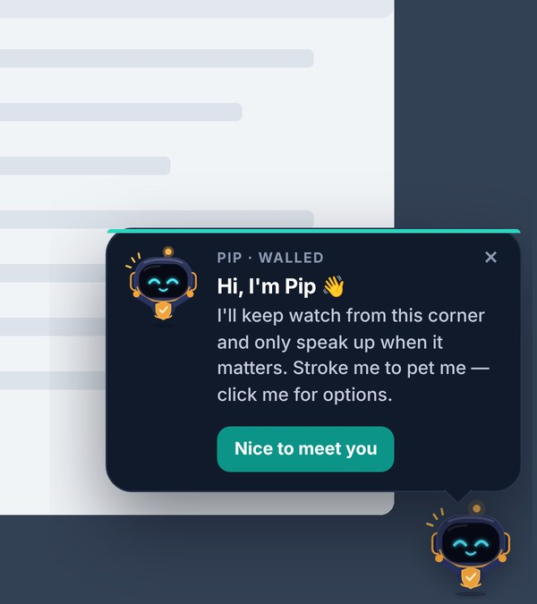</td>
<td>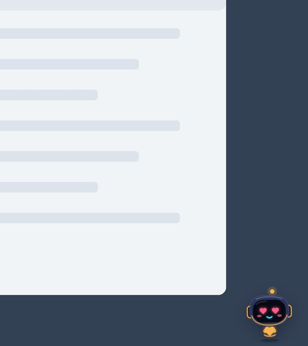</td>
<td>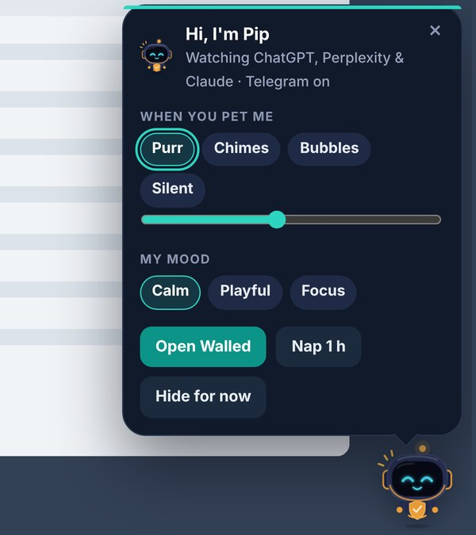</td>
</tr><tr>
<td>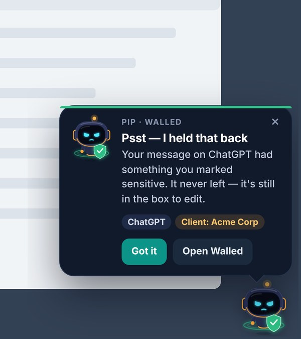</td>
<td>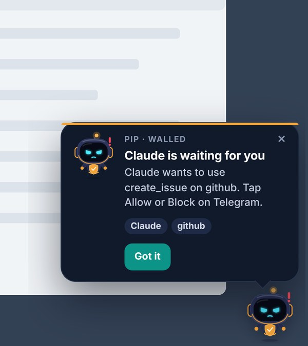</td>
<td>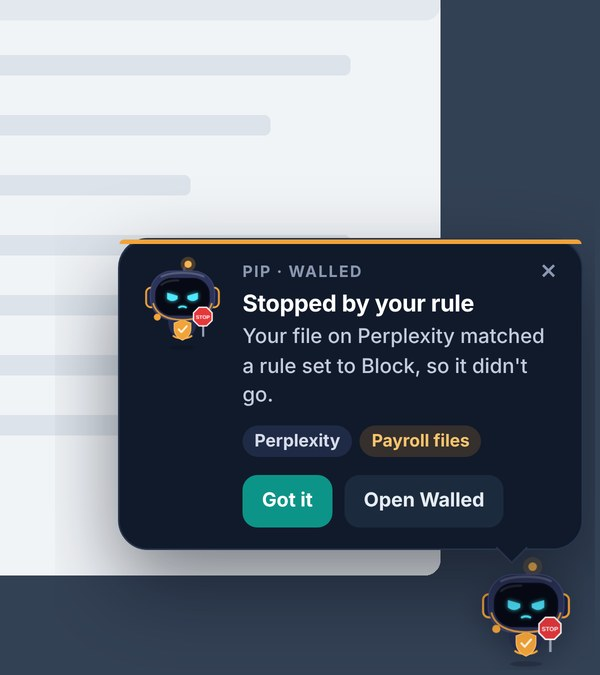</td>
</tr></table>

Turn him off, move him to the other corner, or pick where he lives (screen corner, browser corner or both) in **Settings → Pip**, where you can also preview every sound. Run `walled pet` to call him back after "Hide for now".

The app itself is built for work. A sidebar leads to Data policies, Browser, Claude tools, Telegram, Passwords, Audit log, Verification and Settings. The **Overview** shows security posture, interceptions, phone decisions, protection status per surface, recommended actions and recent activity. Pip only adds a one-line greeting.

<p align="center">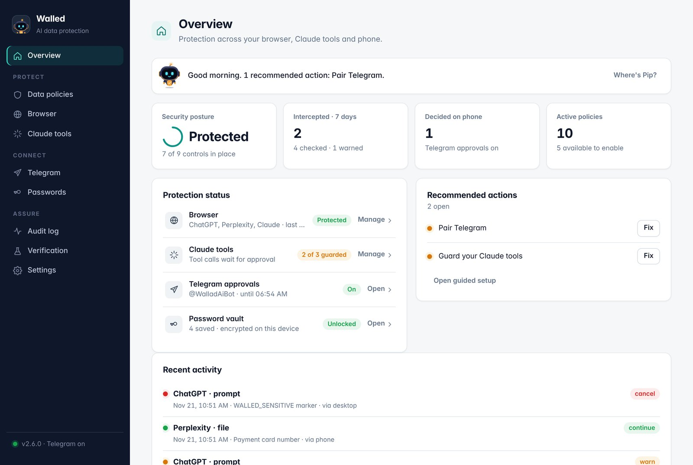</p>

---

## Install (about a minute, one double-click)

All install commands are also on one page: [`site/index.html`](site/index.html) (host it on GitHub Pages). An agent can set up and test everything for you with the prompt in [`docs/AGENT_SETUP.md`](docs/AGENT_SETUP.md).

You need macOS or Linux, Python 3.10+ (macOS offers to add it), and Chrome, Edge, Brave, Chromium or Arc.

1. Unzip `walled-shield-2.6.0-installer.zip`.
2. **macOS:** double-click **Install Walled.command**. The first time, macOS may say the file is from an unidentified developer: right-click it, then **Open → Open**.
   **Linux:** run `bash install.sh` in that folder.
3. Chrome opens on its Extensions page with the extension folder **already copied**. Do the 3 clicks Chrome requires: **Developer mode → Load unpacked → ⌘⇧G ⌘V Enter → Select**. Chrome doesn't let any app do this part for you.

That's it. Walled opens and Pip walks you through Telegram, your rules and passwords.

What the installer does, without asking anything:

- installs into its own `~/.walled` (your system Python isn't touched);
- connects the desktop agent to every Chromium browser;
- starts at login;
- adds **Walled.app** (macOS) or an app-menu entry (Linux);
- copies the extension to a stable folder.

If Homebrew is present, it also adds screenshot reading (Tesseract) in the background. If something fails, it shows the last lines of `~/.walled/install.log` and what to do. You can delete the unzipped folder afterwards.

**To remove Walled:** double-click **Uninstall Walled.command** (or `bash install.sh --uninstall`).
**Lost the extension step?** Run `walled extension`, or press **Open Chrome's extension page** in the app.

From source: `git clone … && cd walled-shield && bash install.sh`.

### Guided setup, with verification at every step

<p align="center">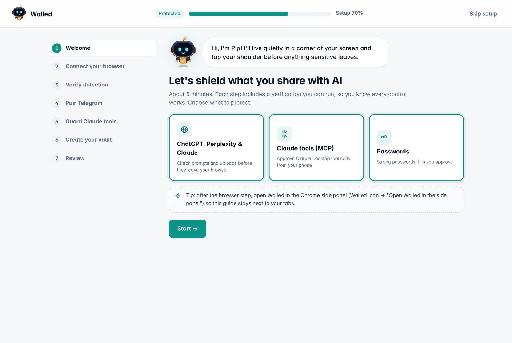</p>

- **Steps:** browser, detection check, Telegram, Claude tools, vault. **Back** works; you can jump to any step from the rail, skip a step, or run setup again later.
- **Progress is evidence-based:** a step counts only when the control is observed working (the extension connects, a prompt is actually intercepted), not when you click Next.
- **A real test in every step:**
  - *show the desktop dialog*;
  - *a Telegram Allow/Block card*;
  - *the race*: the same question on your Mac and your phone, where the first answer wins and the other closes;
  - *sample files* to upload;
  - *a practice sign-up and login page* for the password helper.

## Lives in Chrome: no more app ↔ browser switching

- **Side panel:** click the Walled icon, then **Open Walled in the side panel**. The full app sits next to your tabs (rules, Telegram, tests, vault), so you never minimise Chrome to find it.

  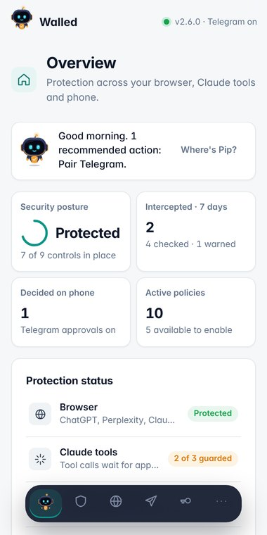
- **Companion cards:** on ChatGPT, Perplexity, Claude and Telegram Web, small branded cards confirm each step as it happens ("Telegram paired", "Vault created", "Test passed"). Each protected site gets a one-time welcome card.
- **Live sync:** the service, the app, the extension and the bot share one event stream. Do something in the browser and the app updates on its own; pair from Telegram and the page you're on says so.

## Telegram: one private bot

**Pairing, guided in Telegram Web (recommended).** Walled opens web.telegram.org and walks you through it:

1. If you're not logged in, it waits while you scan the QR code with your phone.
2. Once you're in, it asks permission: *"Walled can open @BotFather and type the setup messages for you. Nothing is sent without your click."*
3. You click **Send /newbot**, then **Send name**, then **Send username**. The username is suggested and editable; if it's taken, Walled offers another. **/help** is one click away for first-timers.
4. When BotFather replies with the token, Walled **spots it on the page**, so there's nothing to copy. You click **Connect to Walled**.
5. Walled opens your new bot and you press **START**. The app and the page both confirm: *Paired*.

Prefer to do it yourself? Paste a token instead. You still get a one-tap **Open in Telegram → START** deep link, a 2-minute countdown and a ✓.

| What arrives | Buttons | What is shown |
|---|---|---|
| Claude MCP tool call | Allow · Block · Always allow | Tool, server and inputs; inputs are hidden and *Always allow* is removed when they contain sensitive data |
| Sensitive data in a web chat | Allow · Block (if the rule says *Answer*) | Site, file names, rule names, masked sample (`•••• 1111`) |
| Password fill | Allow · Block | Site and masked account, **never the password** |
| **Activity log channel** (optional) | — | A separate group or channel with a quiet, masked feed of every decision. Pair it in one tap ("Add bot to a group"). |

Approvals pause after 24 hours or on `/pairout`. Turning them back on needs a code shown in the app, so nobody can switch them on from Telegram alone. Commands: `/status /guard /vault /lock /rules /clear /pairout /help`.

## What counts as sensitive: you decide

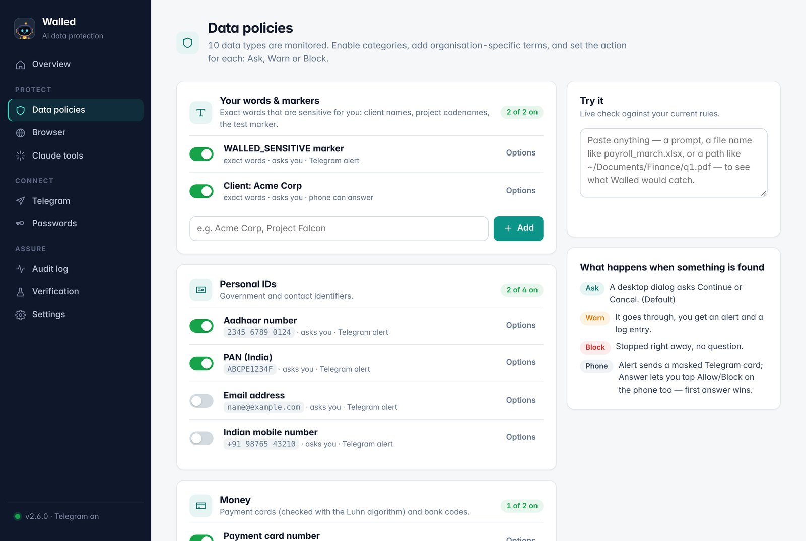

| Category | Examples | Notes |
|---|---|---|
| **Your words & markers** | `WALLED_SENSITIVE`, client names, codenames | Exact text; tolerant of line breaks in files and OCR noise in images |
| **Personal IDs** | Aadhaar (with checksum), PAN, email, Indian mobile | |
| **Money** | Card numbers (Luhn-checked), IFSC | |
| **Secrets & keys** | OpenAI, Anthropic, GitHub, AWS, Slack, Google and Telegram tokens; private keys; JWTs; "password: …" | |
| **Files & folders** | `*payroll*`, `~/Documents/Finance` | Folder rules apply to Claude tool calls |
| **Advanced patterns** | `\bEMP-\d{6}\b` | Regexes that would hang the app are refused |

Each rule has three settings:

- **When found:** Ask (desktop dialog), Warn (let through and record), or Block.
- **Telegram:** Off, Alert (masked card), or Answer (phone and desktop race).
- **Applies to:** web chats and/or Claude tools.

The **Try it** box shows live what would be caught. Walled also **learns from your decisions**, for example: *"You let 'Email address' through 9 of 10 times. Switch it to Warn?"*

## Passwords: clear and safe

- **Two ways to protect the vault:**
  - **Unlock with this Mac (Keychain)**, the recommended option: a random 256-bit key kept by macOS, with nothing to remember. macOS may ask for your Mac password.
  - **A vault passphrase**: the app says plainly *this is not your Mac password*. It offers a memorable 4-word suggestion and asks you to confirm you've saved it.
- **Encryption:** AES-256-GCM over the whole file, with an scrypt key that lives only in memory while unlocked. The vault auto-locks after inactivity, and `/lock` from your phone locks it immediately.
- **Browser helper:** offers strong passwords on sign-up forms and fills logins after your approval, on https pages only. It decides which site a password belongs to from the browser tab, never from the page.
- **No password-manager capture:** Walled's own token and passphrase fields are not password fields, and the app window's browser profile has password saving turned off. Google Password Manager never pops up for your bot token or vault passphrase.

## Test center

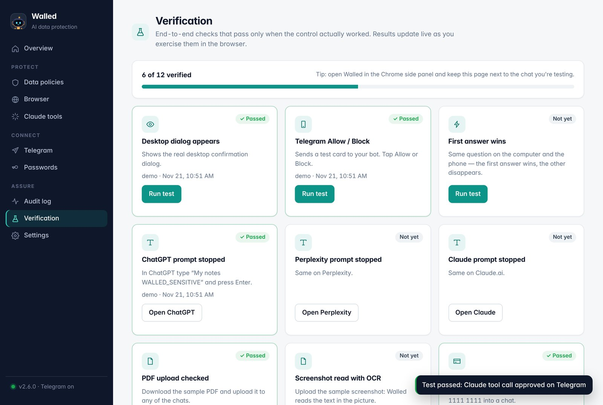

There are 12 end-to-end checks, and each one passes only when it really happened:

- the desktop dialog;
- Telegram Allow/Block, and the race;
- prompts stopped on ChatGPT, Perplexity and Claude;
- a PDF and a screenshot caught;
- a card number detected;
- password save and fill on the practice pages;
- a Claude tool call approved.

Results update live while you try things in the browser.

## The native dialog

macOS shows a real alert (NSAlert):

- the Walled icon and a clear headline (*"Sensitive data in your ChatGPT prompt"*);
- what was found, and your prompt or the file list in a scrollable box;
- **Cancel** as the default button.

The same question can be answered from Telegram; whichever answer comes first closes the other. Linux uses zenity, kdialog or xmessage; Windows uses a native window.

## Project layout

```text
walled-shield/
├── install.sh                 one-step installer (macOS/Linux); packaging/ adds the double-click launchers
├── pyproject.toml             Python package "walled-shield" (CLI: walled)
├── src/
│   ├── walled/                the product: service, Control Center (web/), vault, Pip window (pet.py), installer
│   │   └── extension/         the Chrome extension (MV3): guard, companion cards, Pip (pip-art.js, buddy.js)
│   ├── walled_guard/          browser guard: rules engine, file inspection, native dialog, native-messaging host
│   └── mcp_approval_gate/     Claude MCP approval gate and Telegram approver
├── tests/                     unit, integration and real-browser end-to-end tests
├── docs/                      ENTERPRISE · SECURITY · SECURITY-REVIEW · ARCHITECTURE · SOUNDS · AGENT_SETUP · DEMO
├── site/                      product website (build: python scripts/build_site.py → site/index.html)
├── scripts/                   build_release.py (installer, wheel, extension zip) · build_site.py · make_samples.py
└── assets/                    screenshots, Pip character sheet, architecture diagram
```

Release files for GitHub Releases come from `python scripts/build_release.py` (written to `dist/`, not committed):
- `walled-shield-<v>-installer.zip`, what end users download;
- the wheel;
- `walled-extension-<v>.zip`, for the Chrome Web Store;
- `SHA256SUMS`.

## Commands

```text
walled app                  open Walled (or use Launchpad / the Chrome side panel)
walled doctor               check every part and say exactly what to fix
walled extension            open chrome://extensions with the extension folder path copied
walled pet                  put Pip back in the corner of your screen
walled status               what's running
walled install | uninstall [--purge]
walled guard scan FILE...   check files the way an upload is checked
walled mcp wrap-desktop     guard Claude Desktop tools from the terminal
```

## How it fits together

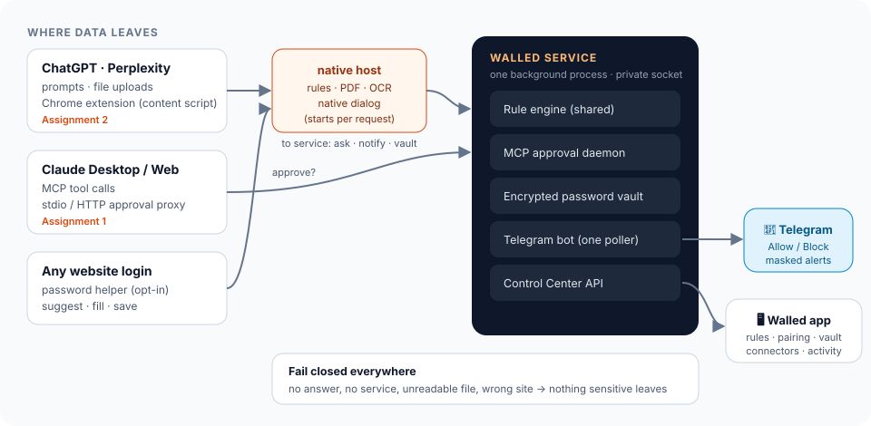

- **Extension:** intercepts in the page, checks rules locally, shows the companion and the Telegram Web assistant, and hosts the side panel. It talks to the desktop agent through Chrome native messaging.
- **Desktop agent:** inspects files, shows the native dialog, and keeps a live event channel open.
- **Walled service:** one background process that owns the rule engine, the event bus, the vault, the Telegram bot (with the MCP approval daemon) and the Control Center API.

Details: [docs/ARCHITECTURE.md](docs/ARCHITECTURE.md) · Security: [docs/SECURITY.md](docs/SECURITY.md) and [docs/SECURITY-REVIEW.md](docs/SECURITY-REVIEW.md) · Demo script: [docs/DEMO.md](docs/DEMO.md).

## Assignment requirements: where each one is met

**Screening 2: Sensitive Upload Guard**

| Requirement | Where |
|---|---|
| Monitor ChatGPT and Perplexity prompts and uploads (and Claude.ai) | `src/walled/extension/src/content.js`; site selectors in `src/walled/extension/src/sites.js` |
| Inspect before transmission: text, PDF, image | `src/walled_guard/inspector.py` (PDF text, raw streams and OCR; images via OCR) |
| Native desktop dialog stating prompt vs file, with the name, Continue / Cancel | `src/walled_guard/dialogs.py` (NSAlert on macOS) |
| Continue proceeds unchanged; Cancel blocks and lets you edit and retry | replay or restore in `content.js` |
| No marker → no interaction | local rule check in the page |
| Recolour AI responses | injected CSS, colour picker in the popup |

**Screening 1: MCP Approval Gate:** see [docs/mcp-gate/](docs/mcp-gate/). It runs inside the Walled service, and `mcp-approval-gate` still works.

## Development

```bash
pip install -e ".[dev,ocr]" && python scripts/make_samples.py
pytest tests/mcp tests/guard tests/platform    # 282 tests
xvfb-run -a pytest tests/e2e                   # 31 browser tests (drop xvfb-run on macOS)
mypy src                                       # strict
python scripts/build_release.py                # dist/: wheel, extension zip, installer bundle, SHA256SUMS
```

The browser tests drive a real Chrome with the real extension, agent and service on stand-in pages for ChatGPT, Perplexity, Claude and Telegram Web. They cover:

- the full BotFather flow;
- the side panel;
- companion cards;
- the copy guard;
- the password helper;
- the guided setup.

## Known limits

- **Site redesigns:** if ChatGPT, Perplexity, Claude or Telegram Web change their markup, update `src/walled/extension/src/sites.js` (or the selectors at the top of `telegram.js`).
- **Disabling the extension:** users can switch it off; managed rollouts should force-install it by policy.
- **Platforms:** the vault, Telegram and the side panel need macOS or Linux and Chrome 116+.
- **Iframes:** forms inside cross-origin iframes are not covered by the password helper.
- **Sounds:** Pip ships synthesized sounds. To use recorded ones, follow the brief in [docs/SOUNDS.md](docs/SOUNDS.md).
- **Pip on the desktop:** needs pywebview (the installer adds it); on Linux also GTK or Qt bindings, otherwise he lives in the browser corner. Desktop sounds may stay silent until you pet or click him once, because web views keep audio asleep until a first touch.
