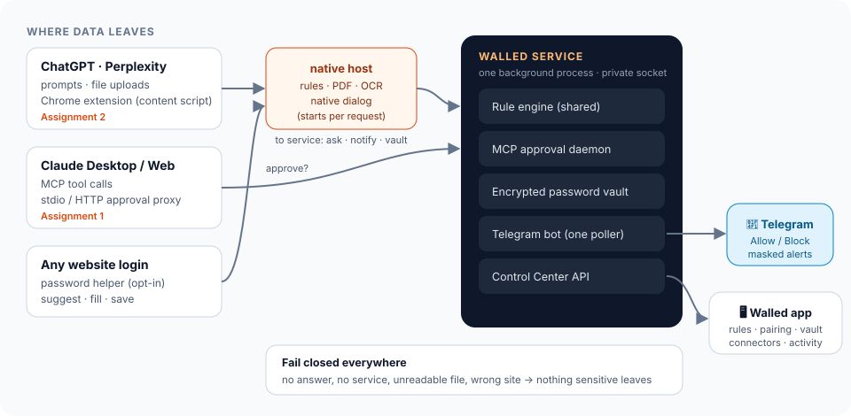

# Architecture

Walled Shield merges two assignments that protect the same layer, which is data on its way to an AI:

- **Browser guard** (Screening 2) catches prompts and uploads to ChatGPT and Perplexity. Its detailed design is in [browser-guard.md](browser-guard.md).
- **MCP approval gate** (Screening 1) catches Claude's tool calls. Its detailed design is in [mcp-gate/ARCHITECTURE.md](mcp-gate/ARCHITECTURE.md).

The merge adds three shared pieces: **one rule engine**, **one background service** that owns the Telegram bot, and **one desktop app** to manage everything. It also adds a password vault, because the same Telegram approval channel and the same "nothing secret leaves" policy suit it.

## v2.6: enterprise app, flat design system, livelier Pip

- **App:**
  - desktop sidebar (dock only when compact) and an Overview page;
  - Data policies, Audit log and Verification;
  - evidence-based setup progress instead of XP;
  - `GET /api/activity/export?format=csv|json` returns the content-free audit trail as a download.
- **Design system:** calm slate and teal, flat colour only, a 4-px spacing grid, and a 12/13/14/16/22 type scale. Pip and the icons are flat too.
- **Pip:**
  - pauses of 1–5 s between activities (walk, hop, spin, chase, dance, wave, stretch, peek, play, busy, calm, guard), so he never stands still;
  - stops to pay attention while the pointer is over him;
  - attention-seeking ("pet me?") with a 12 s window;
  - over-petting after 8 s makes him grumpy, with a 7 s sulk.
- **Recorded sounds:** an `index.json` manifest lists the files. Desktop files come from `<state>/sounds` then the packaged folder; the extension serves its own `sounds/` as web-accessible resources. Each sound falls back to its synthesized version.

## v2.5: Pip's character and a simpler way to use him

- **One character file** (`src/walled/extension/src/pip-art.js`):
  - **The art:** vector Pip drawn after the character sheet, with 16 expressions plus a resting face.
  - **How expressions switch:** each expression is a row in `EXPR` (eyes, mouth, pose, marks, aura). Applying one sets data attributes, and CSS shows the matching parts, so one SVG covers every expression with no image files.
  - **Where it's used:** the corner pet, his notes and panel, the app (home, top bar, dock, setup quest), the browser companion cards, and the app and extension icons.
  - **Protecting** uses the green aura and shield.
- **Interaction:**
  - **Gestures:** stroke to pet (shy → love), click for one panel.
  - **First run:** a one-time hello (`pet.intro`).
  - **Notes:** each shows the expression for its event.
  - **Removed:** boop-only clicks, double-click and the separate right-click menu (right-click still opens the same panel).

## v2.4: Pip lives in a corner

- **One runtime, two homes** (`src/walled/extension/src/buddy.js`):
  - **Desktop:** `walled pet` opens a frameless, transparent, always-on-top pywebview window, 230×124 px, which grows to 360×450 px while a note or the menu shows. The window is pinned to a screen corner and shows `buddy.html` from the Control Center (one-time ticket). The service starts it 2 s after it starts if Pip is enabled. Its pid file (`pet.pid`) tells everyone else he's on screen.
  - **Browser:** when no desktop Pip is alive, or the setting says *browser* or *both*, the host's ping reply sets `pet.in_browser`. `buddy-browser.js` then mounts him in an open shadow root in the corner of ChatGPT, Perplexity and Claude. There he only speaks up for held-back data and Claude waiting; setup news stays in the companion cards.
- **Behaviour:** a weighted idle scheduler per mood (walk, look, guard, play, yawn, nap, vanish). Event moods hold off idle behaviour for a few seconds. Notes have a rank, so an alert is never replaced by small news.
- **Petting and sound:**
  - Pointer strokes are tracked (distance and speed) and drive the petting sound.
  - Sounds are synthesized with Web Audio: no files, and a gentle low-pass on everything.
  - Purr is brown noise through a 340 Hz low-pass, amplitude-modulated at 23 Hz. Wind chimes use C-major pentatonic mallets. Bubbles are short rising sine sweeps.
  - Alerts are triangle tones through a 1.5 kHz low-pass.
- **Events:** the daemon gained an `on_approval` hook. The service publishes `claude.waiting` only if a human is still being asked after 1.5 s, and `claude.decision` afterwards. Settings changes publish `pet.settings`, so Pip follows the app live.
- **CSP:** the app's strict `style-src 'self'` is respected by using constructed stylesheets (`adoptedStyleSheets`).

## v2.3: Pip, performance and a one-step install

- **Pip** (`web/pet.js`) replaces the dashboard home. It is a mood state machine (idle, happy, alert, think, sleep, sad, celebrate) plus life loops: blinking, glances, pointer tracking, dozing after 45 s, and vanishing into a wandering spark after 3 min. It is drawn as CSS-animated SVG, so it uses no canvas and runs no frame loop.
  - **Reactions:** `pipReaction(event)` maps the live event stream to a mood and a sentence. On the home screen, Pip speaks and pushes a card; elsewhere, the top-bar Pip reacts.
  - **Lifecycle:** the long-lived home and top-bar Pips are kept. Throwaway Pips (onboarding) stop their timers and listeners once they leave the page.
  - **Browser cards:** the companion cards embed a static mini Pip whose eyes follow the card's tone.
- **Install:**
  - The release bundle has `Install Walled.command` / `Uninstall Walled.command` (macOS double-click) next to `install.sh`.
  - The installer asks nothing, logs to `~/.walled/install.log`, and installs Tesseract in the background only if Homebrew is present.
  - `walled extension` (also `POST /api/browser/extensions`) opens `chrome://extensions` in the first Chromium browser found and copies the extension folder path to the clipboard. That reduces the step Chrome reserves for the user to three clicks.
- **Performance:**
  - Dialog subprocesses are watched and reaped, never left orphaned.
  - Rule engines are cached per config.
  - The image metadata walk is bounded.
  - The raw-PDF fallback scans as it reads.
  - Extension calls use 15 s timeouts, except the three that wait for a human.
  - Reconnects and vault backoff are jittered.
  - The content-script sync timer stops when the extension is reloaded.

## v2.2: one ecosystem

- **Event bus** (`walled/events.py`): everything that happens is published once (paired, vault created, prompt stopped, test passed). The app polls `/api/events`. The extension keeps one native-messaging port open (`{"type":"subscribe"}`), through which the host long-polls the service's `events` op and forwards each event. The background worker relays events to the active tab's **companion** and to the **side panel**, and acts on `assist.*` events, for example opening Telegram Web for the guided BotFather flow.
- **Browser to app:** the Telegram Web assistant or the copy guard sends `pair_token` to the service, which starts pairing and returns the deep link. The side panel asks for a `ticket` to load the app without a window.
- **Activity mirror:** the host reports every decision (`activity` op), and the service publishes it and mirrors it to the Telegram log channel.
- **Test center:** results are derived from real events and stored in settings, where both the onboarding and the Test center read them.

## Processes

| Process | Lifetime | Responsibility |
|---|---|---|
| **Extension** (Chrome MV3) | always, in the browser | Intercepts sends, uploads, drops and pastes in the capture phase, before the site sees them. Checks keyword, detector and regex rules locally. Replays approved actions. Recolours answers. Runs the password helper (opt-in). |
| **Native host** (`python -m walled_guard host`) | started by Chrome for each request | Inspects files (text, PDF, OCR) and shows the **native dialog**. Asks the service for Telegram alerts and answers. Forwards vault requests. |
| **Walled service** (`python -m walled service`) | background (launchd / systemd) | Owns the Telegram bot (the A1 approval daemon) and the private Unix socket. Holds the vault key while the vault is unlocked. Serves the Control Center API on 127.0.0.1. Applies rules to MCP calls. |
| **MCP proxies** (`mcp-approval-gate stdio/http`) | started by Claude Desktop for each server | Unchanged from A1. They ask the service with `{"op":"approve"}` over the socket. |
| **Walled app** | while open | A window (pywebview or a Chrome app window) showing the Control Center UI |

Only the service talks to Telegram, which allows exactly one `getUpdates` consumer per bot. Everything else asks the service.

## Socket protocol (one JSON line each way, private 0600 socket)

| Op | From | Meaning |
|---|---|---|
| `approve` | MCP proxy | A1 contract: Allow/Block on Telegram, rule-aware |
| `status` / `renew` | CLI, app, host | Health and 24 h session renewal |
| `ask` | native host | Allow/Block question on Telegram. Closing the socket withdraws it. |
| `notify` | native host | A masked alert card |
| `vault_find` / `vault_fill` / `vault_save` / `vault_status` | native host (password helper) | Vault access; a fill may require an `ask` first |

When the service is not running, `ask` and `notify` are simply unavailable. **The browser guard keeps working with the desktop dialog alone**, which is exactly the Screening-2 behaviour. MCP approvals fail closed, as in A1.

## One rule engine, three surfaces

`walled_guard/rules.py` compiles the rules once and scans text in one of three modes:

- **typed:** prompts, matched exactly;
- **extracted:** text from files and PDFs; keywords also match across line breaks;
- **OCR:** text read from images; keywords also tolerate look-alike characters.

| Surface | Where the scan happens | What is scanned |
|---|---|---|
| Browser prompt | extension, locally (`browser_export()` → JS), then the native host again (the authority) | prompt text |
| Browser upload | native host | file name, decoded text, PDF pages and streams, OCR of images and scanned pages |
| Claude MCP call | service → `ApprovalDaemon.inspect` | every string in the arguments, plus folder and file-name rules on path-like strings |

Patterns are limited to syntax that Python and JavaScript share, and a test runs the exported rules in Node to prove both find the same hits.

## Decision policy

The strongest action among the matching rules wins: **block > ask > warn**.

- **warn:** the item goes through, with an alert if the rule's Telegram setting is Alert or Alert + answer.
- **block:** the item is stopped and an alert is sent; no dialog appears.
- **ask:** the native dialog appears. If any matching rule has Telegram set to **Alert + answer**, the same question also goes to Telegram:
  - The host runs both questions in threads; the first *real* answer wins.
  - A Telegram answer counts only when it is an actual tap. An expiry, approvals being off, or Telegram not being set up leaves the decision to the dialog.
  - The loser is withdrawn: the dialog program is killed, or the Telegram socket is closed, which removes the buttons.

For MCP calls, any matching rule turns off *Always allow* for that call and hides its inputs on the card. A matching block rule refuses the call immediately.

## Data that crosses each boundary

| Boundary | Carries | Never carries |
|---|---|---|
| Extension → native host | prompt text and file bytes (local pipe) | — |
| Host → service | masked alert text and the question | prompt text, file contents |
| Service → Telegram | rule names, masked samples, file names, site, masked account name | prompt text, file contents, passwords, MCP inputs with sensitive data |
| Service → host (fill) | username and password, after approval | — |
| Logs | time, site, kind, decision, rule names, how decided | any content |

## Control Center

- `walled/control.py` is a stdlib `ThreadingHTTPServer` bound to `127.0.0.1` on a random port.
- Access is guarded by a per-start token passed in the URL fragment, a Host-header check against DNS rebinding, a strict CSP, and no CORS.
- The UI (`walled/web/`) is plain HTML, CSS and JS, and builds the DOM with `textContent` only.
- Telegram pairing runs in a background thread that reuses A1's `pair_private_chat`. It stops the running bot while pairing, because a bot has one poller, and then hot-starts the new bot.

## Tests

| Suite | Count | What it proves |
|---|---|---|
| `tests/mcp` | 129 | The full A1 suite on the merged code |
| `tests/guard` | 70 | Inspector, dialogs (including cancellation), native protocol, installer and doctor |
| `tests/platform` | 80 | The real service over its real socket with a fake Bot API: phone or desktop winning the race, masked alerts, warn and block rules, the guard without the service, MCP calls with sensitive data and folder rules, vault fills approved or blocked on Telegram with the password never sent, cross-site fill refusal, `/lock`, Control Center auth, rules, vault, connectors and settings; plus rule-engine and Python/JS parity, and the v2.1 security fixes, insights, onboarding, deep links and packaging |
| `tests/e2e` | 31 | Real Chrome with the extension and agent: all Screening-2 flows, custom rules synced from the app, built-in detectors, password suggest → save → fill, locked vault, and a page unable to press the chip, and the Control Center launch ticket and setup quest |
